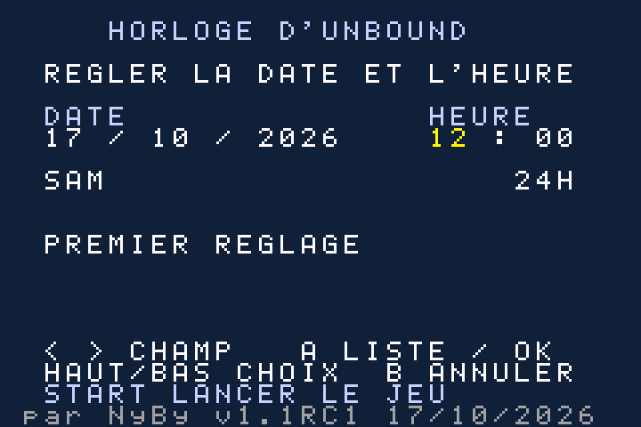
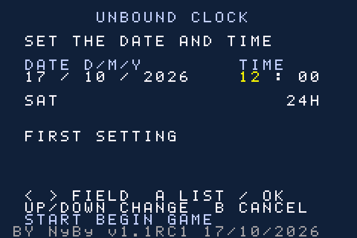

# NyBy RTC — Pokémon Unbound EN / FR

> **Bêta v1.5-beta2 / v1.5-beta2 beta :** [Télécharger / Download](https://github.com/neylibry/nyby-unbound-rtc/releases/tag/v1.5-beta2) · [Guides et sources / Guides and source](beta/v1.5-beta2/README.md) · [Changements techniques / Technical changes](beta/v1.5-beta2/RELEASE-FR-EN.md). Vérification complète du secteur et réessai avec tampon conservé ; moteur RTC en partie inchangé. / Full-sector verification and retained-buffer retries; unchanged in-game RTC engine. Tests PC FR/EN ; validation matérielle en attente / Hardware validation pending.

Une horloge manuelle pour jouer à Unbound sur **vraie GBA + SuperCard sous SuperFW 0.21**, sans puce RTC. / A manual clock for Unbound on **real GBA + SuperCard running SuperFW 0.21**, without an RTC chip.

**v1.1RC1 · 17/10/2026 · Kit communauté r4 · code original MIT**

[Télécharger le kit / Download the package](https://github.com/neylibry/nyby-unbound-rtc/releases/tag/v1.1-rc1-community-r4) · [Guide français](README_FR.md) · [English guide](README_EN.md)

## Français

Réglez la date et l'heure au démarrage ; elles avancent pendant le jeu. Le dernier réglage saisi est mémorisé. Le temps console éteinte n'est pas compté : remettez l'heure au lancement.

Les deux parcours partent de votre propre **FireRed USA v1.0 en anglais** :

- **Jeu EN :** FireRed USA → patch Unbound 2.1.1.1 → patch RTC NyBy EN.
- **Jeu FR :** FireRed USA → patch Unbound 2.1.1.1 → traduction Antony FR 2.1.179 → patch RTC NyBy FR.

Ce kit effectue uniquement la dernière étape RTC. L'installateur reconnaît par SHA-256 votre fichier Unbound **déjà préparé** et sélectionne le patch RTC correspondant. Le sélecteur de langue de l'installateur change uniquement son interface.

**Installation :** extraire le kit, ouvrir `INSTALLER-FR-EN.html`, choisir Unbound préparé et éventuellement son .sav natif de 128 Kio, puis générer le ZIP personnel prêt à copier sur la SD. Aucun Python, compte ou accès réseau nécessaire. Conservez une copie de votre partie avant installation.

**SuperFW :** PatchEngine, DirectSaving activé, RTC SuperFW / IGM / cheats désactivés. Les caches sont fournis : ne pas les régénérer.

Le kit public ne contient aucune ROM, traduction complète ou sauvegarde personnelle. Le ZIP généré avec vos fichiers est destiné à votre usage personnel.

## English

Set the current date/time at startup; it advances while playing. The last setting you entered is remembered. Powered-off time is not counted: adjust the clock at each launch.

Both paths start from your own **English FireRed USA v1.0**:

- **EN game:** FireRed USA → Unbound 2.1.1.1 patch → NyBy RTC EN patch.
- **FR game:** FireRed USA → Unbound 2.1.1.1 patch → Antony French 2.1.179 translation → NyBy RTC FR patch.

This package handles only the final RTC step. The installer fingerprints your **already prepared Unbound build** using SHA-256 and selects the matching RTC patch. Its language selector changes only the installer interface.

**Setup:** extract the package, open `INSTALLER-FR-EN.html`, select prepared Unbound and optionally its native 128 KiB .sav, then generate your personal SD ZIP. No Python, account or network access required. Back up your save first.

**SuperFW:** PatchEngine, DirectSaving enabled, SuperFW RTC / IGM / cheats disabled. Matching caches are included: do not regenerate them.

The public package contains no ROM, complete translation or personal save. Generated ZIPs containing your files are for personal use.

## État / Status

- **FR :** fluidité confirmée par un utilisateur sur GBA. / Smooth gameplay reported by a user on real GBA.
- **EN :** tests PC réussis, sauvegarde/reprise et calendrier exhaustif ; essai GBA encore à confirmer. / PC checks passed, including native save/resume and exhaustive calendar; hardware test pending.
- **RC1 :** signalement d'affichage intermittent des choix dans les paramètres toujours ouvert. / Intermittent disappearing Options choices issue remains open.

[Vérifications / Verification](docs/VERIFICATION-FR-EN.md) · [Preuves installateur / Installer checks](docs/INSTALLER-TESTS.json) · [Validation EN / EN validation](docs/EN-VALIDATION.json)

## Aperçus / Previews

| Français | English |
|---|---|
|  |  |

## Sources et crédits / Source and credits

[Sources et reconstruction / Source and rebuilding](sources/README-FR-EN.md) · [Crédits / Credits](CREDITS-FR-EN.md) · [Texte de présentation / Release text](ANNONCE-FR-EN.md)

RTC : **NyBy** · Unbound : **Skeli et son équipe / and team** · Traduction FR / French translation : **Antony** · SuperFW : **davidgfnet**.

Projet indépendant. Pour signaler un problème, indiquez les versions, le matériel et les étapes de reproduction ; ne publiez pas de ROM ou de sauvegarde personnelle. / Independent project. Report versions, hardware and reproduction steps; do not post ROMs or personal saves.

## Licence et diffusion / Licensing and distribution

Code original NyBy : **[MIT](LICENSE)**, avec [portée FR/EN](LICENSING-FR-EN.md). / Original NyBy code: **MIT**; third-party game, translation and firmware rights remain separate.

Des parties importantes du code et de la documentation ont été générées avec Codex (IA), sous la direction de NyBy. NyBy a défini le besoin et effectué les essais sur sa GBA. Les tests matériels rapportés concernent la FR ; l'EN reste à confirmer sur console.

Substantial parts of the code and documentation were generated with Codex (AI), directed by NyBy. NyBy defined the requirements and performed the reported GBA testing. Hardware feedback concerns the French build; English hardware testing is still pending.

[Textes et destinations de publication / Publication drafts and destinations](docs/publication/README-FR-EN.md).

r4 ajoute la licence et les documents de diffusion ; patchs et installateur identiques à r3. / r4 adds licensing and publication material; patches and installer are unchanged from r3.
