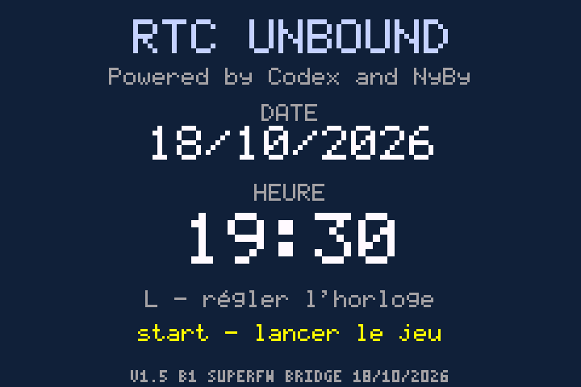
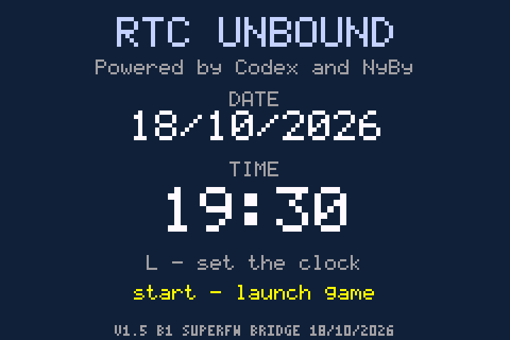
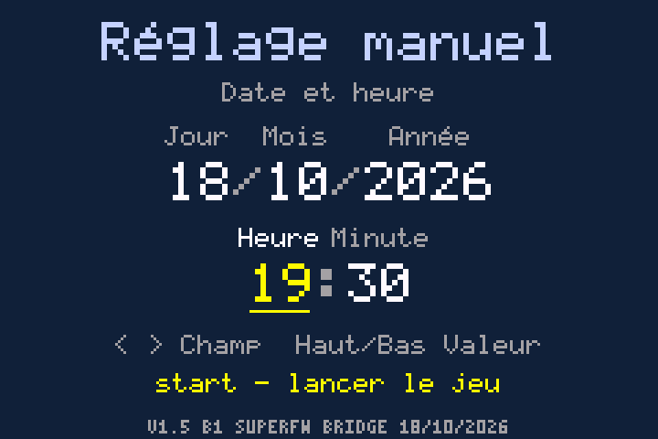
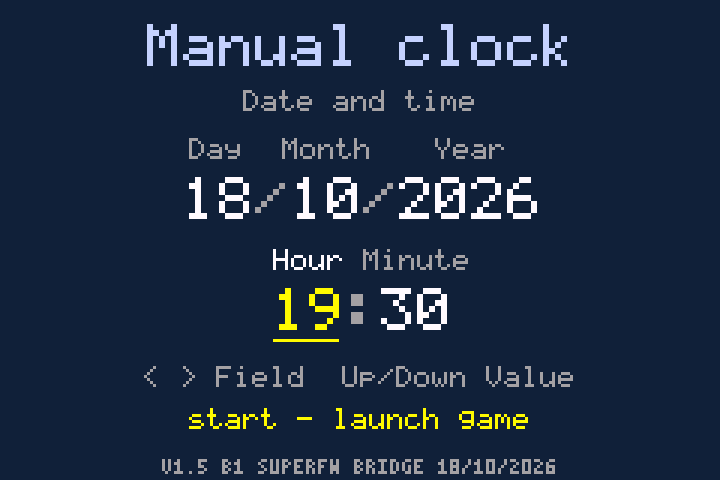

# NyBy RTC v1.5-beta1 — Unbound EN / FR

**Bêta publique · 18/10/2026 · Code original MIT / Public beta · Original code under MIT**

[Guide français](README_FR.md) · [English guide](README_EN.md) · [Tests](docs/AUTOMATED-TESTS.json) · [Crédits / Credits](CREDITS-FR-EN.md)

Une horloge pour Unbound sur SuperCard sans puce RTC : cette bêta lit le réglage manuel de SuperFW 0.21, affiche date/heure et attend START. L ouvre le réglage manuel. Le temps avance ensuite pendant le jeu. Le temps console éteinte reste inconnu.

A clock for Unbound on a SuperCard without an RTC chip. This beta reads SuperFW 0.21's manually configured timestamp, displays date/time and waits for START. L opens manual adjustment. Time then advances during play. Powered-off time remains unknown.

**Installation :** extraire le kit et ouvrir `INSTALLER-FR-EN.html`. Fournir Unbound EN 2.1.1.1 ou FR Antony 2.1.179 sans ancien patch RTC. Le .sav natif de 128 Kio est facultatif. Le HTML fonctionne hors ligne et génère les fichiers personnels pour la SD.

**Setup:** extract the kit and open `INSTALLER-FR-EN.html`. Supply Unbound EN 2.1.1.1 or Antony FR 2.1.179 without an older RTC patch. A native 128 KiB .sav is optional. The offline HTML generates your personal SD files.

**SuperFW : PatchEngine · RTC activée / enabled · DirectSaving activé / enabled · IGM et cheats désactivés / disabled.** Utiliser les nouveaux caches fournis ; régler date/heure dans SuperFW avant chaque session. / Use the supplied new caches; update the date/time in SuperFW before each session.

**Bêta :** tests automatisés FR/EN réussis sur PC ; trajet complet SuperFW/BIOS et vraie GBA encore à valider. Les retours matériels de v1.1 ne valident pas v1.5. Le signalement historique des choix dans les paramètres reste ouvert.

**Beta:** automated FR/EN PC checks passed; the full SuperFW/BIOS path and real GBA remain untested. v1.1 hardware feedback does not validate v1.5. The previously reported native Options choices issue remains open.

| FR | EN |
| --- | --- |
|  |  |
|  |  |

Aucune ROM, sauvegarde, traduction ou firmware inclus. / No ROM, save, translation or firmware included.
