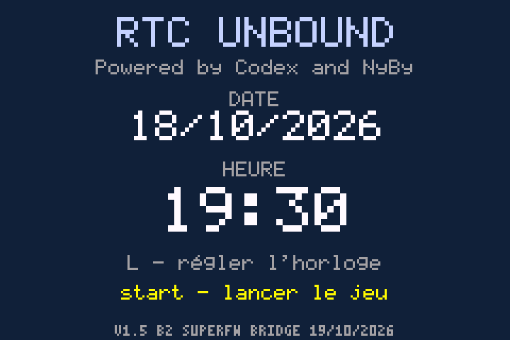
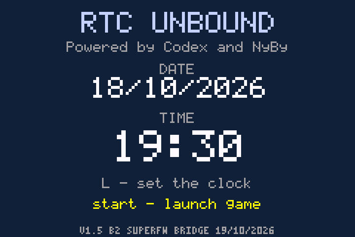
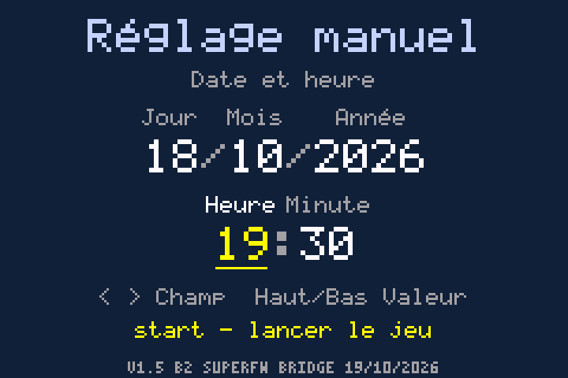
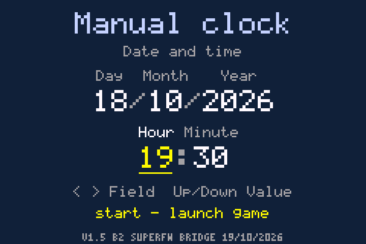

# NyBy RTC v1.5-beta2 — Unbound EN / FR

**Bêta publique · 19/10/2026 · Code original MIT / Public beta · Original MIT source**

[Télécharger / Download](https://github.com/neylibry/nyby-unbound-rtc/releases/tag/v1.5-beta2) · [Guide FR](README_FR.md) · [English guide](README_EN.md) · [Notes techniques / Technical notes](RELEASE-FR-EN.md)

## Français

Cette bêta renforce l'enregistrement de l'heure : comparaison exacte des 4 Kio du secteur après écriture et conservation du tampon sain pour réessayer après une erreur. Le moteur assembleur pendant la partie est inchangé. Le correctif ajoute 76 octets de ROM et 512 octets de pile temporaire au démarrage, sans allocation permanente supplémentaire.

L'horloge récupère le réglage manuel de SuperFW 0.21, affiche la date/heure et attend START. L ouvre le réglage direct : gauche/droite pour le champ, haut/bas pour la valeur. Sans puce RTC, le temps console éteinte reste inconnu ; réglez SuperFW avant chaque session.

**Installation :** extraire le kit, ouvrir `INSTALLER-FR-EN.html` hors ligne, choisir Unbound EN 2.1.1.1 ou FR Antony 2.1.179 sans ancien patch RTC, puis éventuellement une copie du `.sav` natif de 128 Kio de même langue. Le ZIP généré contient les fichiers personnels à copier sur SD. Aucun compte, Python ou réseau nécessaire.

**SuperFW : PatchEngine, RTC activée, DirectSaving activé, IGM et cheats désactivés. Utiliser les caches BETA2 fournis.** La sauvegarde conserve son format ; sa copie est renommée sans conversion.

Validation PC : essais finaux FR/EN, installation HTML et compilation reproductible. Le laboratoire C1, dont le code est identique, couvre notamment 24 redémarrages à froid, 8 sauvegardes natives et 6 048 échantillons de timers. La provenance et les limites sont précisées dans les rapports. Le trajet SuperFW/BIOS et le contrôleur SD réels restent à valider ; une coupure pendant l'écriture n'est pas couverte par une garantie de récupération. Le défaut historique des choix dans les paramètres reste ouvert.

## English

This beta hardens setting persistence: exact post-write verification of the full 4 KiB sector and retention of the intact buffer for retries. The in-game assembly clock engine is unchanged. The fix adds 76 ROM bytes and 512 temporary startup stack bytes, with no additional permanent allocation.

The clock imports SuperFW 0.21's manually configured timestamp, displays it and waits for START. L opens direct adjustment: left/right selects a field; up/down changes its value. Without an RTC chip, powered-off time remains unknown; update SuperFW before each session.

**Setup:** extract the kit and open `INSTALLER-FR-EN.html` offline. Select Unbound EN 2.1.1.1 or Antony FR 2.1.179 without an older RTC patch, optionally supplying a copy of a same-language native 128 KiB `.sav`. The generated personal ZIP contains your SD files. No account, Python or network needed.

**SuperFW: PatchEngine, RTC enabled, DirectSaving enabled, IGM and cheats disabled. Use the supplied BETA2 caches.** Save format is unchanged; files are copied and renamed without conversion.

PC validation includes final FR/EN checks, HTML installation and reproducible builds. The C1 laboratory campaign, with identical executable code, includes 24 cold starts, 8 native saves and 6,048 timer samples. Reports distinguish provenance and limitations. The real SuperFW/BIOS path and SD controller remain untested; recovery after power loss during a write is not guaranteed. The historical native Options choices issue remains open.

| FR | EN |
| --- | --- |
|  |  |
|  |  |

[Vérifications / Validation](docs/VALIDATION-FR-EN.md) · [Tests finaux / Final checks](docs/AUTOMATED-TESTS.json) · [Sources](sources/README-FR-EN.md) · [Crédits / Credits](CREDITS-FR-EN.md)

Aucune ROM, sauvegarde, traduction complète ou firmware inclus. / No ROM, save, complete translation or firmware included.
